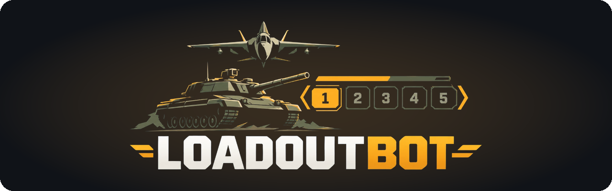
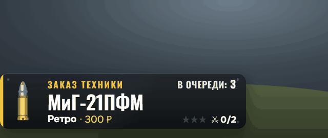
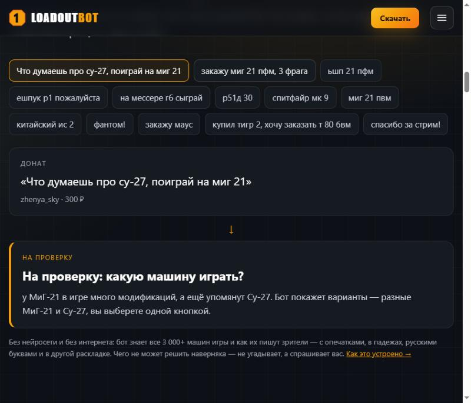
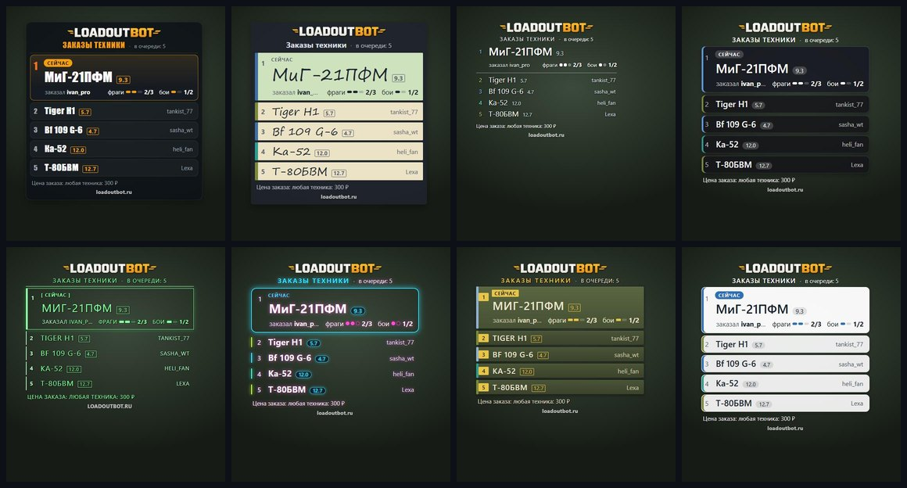
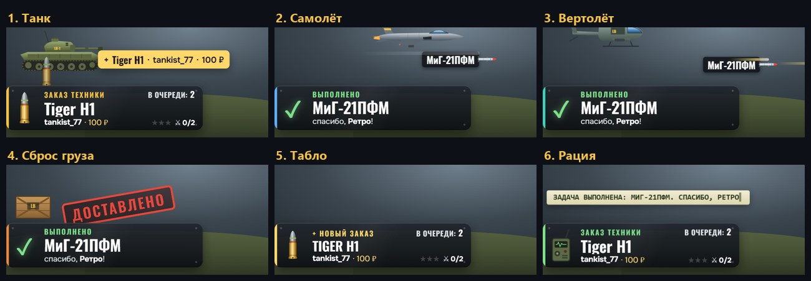
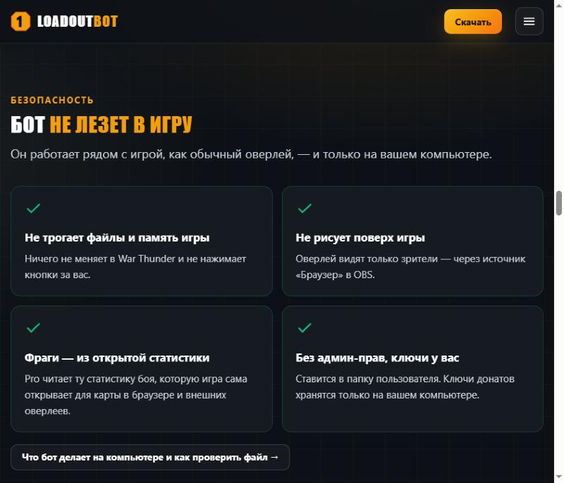

<div align="center">



## Зрители заказывают технику. Ты просто играешь.

**LoadoutBot сам читает донаты, ставит заказы в очередь и показывает её на стриме.**<br>
Бесплатный бот для стримеров War Thunder — без блокнота, табличек и «а кто заказывал Тигр?»

[](https://loadoutbot.ru/LoadoutBot-Setup.exe)
[](https://loadoutbot.ru/?utm_source=github&utm_medium=readme)




<sub>Так заказы выглядят на стриме: живой стиль «Боекомплект», тема «Танк». Новый заказ привозит танк, фраги загораются звёздами, выполненный заказ улетает снарядом. <a href="#живой-стиль-боекомплект--6-тем">Ещё 5 тем ↓</a></sub>

</div>

---

## Знакомо?

Зритель донатит 300 ₽: «сыграй на мессере г6, 3 фрага». Ты в бою. Следом ещё два заказа — разными словами,
один в другой раскладке. После боя: кто первый? что за «р51д 30»? а этот «тигр» — какой из шести?
Через час в чате: «я донатил, почему ещё не сыграл?»

**LoadoutBot забирает это на себя.** Читает донаты, сам находит машину в тексте, сверяет сумму с твоими ценами
и ставит заказ в очередь. Очередь висит на стриме — каждый зритель видит, какой он по счёту.

## Бот понимает, как на самом деле пишут зрители



| Написал зритель | Бот понял |
|---|---|
| `закажу миг 21 пфм, 3 фрага` | МиГ-21ПФМ |
| `Р-51Д-30` (русские буквы) | P-51D-30 |
| `ьшп 21 пфм` (не та раскладка) | МиГ-21ПФМ |
| `ешпук р1` (вся фраза в другой раскладке) | Tiger H1 |
| `на мессере г6` (падеж + прозвище) | Bf 109 G-6 |
| `спитфайр мк 9` | Spitfire Mk.IX |
| `миг 21 пвм` (опечатка) | МиГ-21ПФМ |
| `фантом!` | «На проверку»: какой из F-4? — выбираешь одной кнопкой |
| `спасибо за стрим` | обычный донат, не заказ |

Главное правило: **лучше спросить, чем угадать неправильно.** `миг 23` никогда не станет `миг 21`.
Всё спорное — недобор суммы, несколько вариантов, техника, которую ты не берёшь, — уходит тебе «На проверку» с причиной.

👉 [Как это устроено внутри: склейки слов, раскладки и Дамерау — Левенштейн](docs/articles/kak-bot-ponimaet-donaty.md)

## Что умеет

- 🎯 **Вся техника игры** — самолёты, вертолёты, танки, корабли: 3 000+ машин с БР для РБ/АБ/СБ.
- 💰 **Твои цены** — «самолёты 5.7–8.3 — 300 ₽, премы — 600 ₽ и 5 фрагов, корабли не беру». Бот сам скажет, сколько машин под это попадает.
- 📺 **Оверлей для OBS** — 12 стилей бесплатно, большинство без фона. Одна ссылка, один клик.
- 💥 **Живой стиль «Боекомплект»** (Pro) — заказы привозят танк, самолёт или вертолёт, крупный донат — золотой снаряд. 6 тем на выбор.
- 🎛️ **Stream Deck бесплатно** — «+1 фраг», «Сыграно», выбор машины из «На проверке» — не сворачивая игру.
- 📱 **Пульт с телефона** (Pro) — та же панель по Wi-Fi.
- 🧭 **Мастер на 3 минуты** — донаты, OBS и тестовый заказ при первом запуске.
- 🔄 **Обновляется сам** — кнопка «Обновить сейчас», настройки и очередь на месте.

<div align="center">


<sub>Часть бесплатных стилей: LoadoutBot, Классический, Минимал, Стекло, Прицел, Неон, Армейский, Светлый</sub>
</div>

## Живой стиль «Боекомплект» — 6 тем

<div align="center">

</div>

Не просто список, а маленькая сценка поверх игры. Тема выбирается в панели одним кликом:

| Тема | Что происходит на стриме |
|---|---|
| 🛡️ **Танк** | Новый заказ привозит танк с табличкой, выполненный улетает снарядом |
| ✈️ **Самолёт** | Заказ проносится на самолёте, выполненный уходит ракетой |
| 🚁 **Вертолёт** | Заказ прилетает на вертолёте |
| 🪂 **Сброс груза** | Заказ спускается ящиком на парашюте, выполненный — штамп «ДОСТАВЛЕНО» |
| 🔢 **Табло** | Строки перелистываются, как на табло вылетов |
| 📻 **Рация** | Заказы приходят радиосообщением: «Принят заказ…», «Задача выполнена…» |

Во всех темах фраги загораются звёздами, а снаряд в карточке зависит от суммы: от 1 000 ₽ — золотой снаряд, от 5 000 ₽ — особый.
«Боекомплект» входит в Pro, его можно попробовать 7 дней бесплатно.

## Начать за 3 минуты

1. **[Скачай установщик](https://loadoutbot.ru/LoadoutBot-Setup.exe)** (≈50 МБ, Windows 10/11, без прав администратора).
2. Запусти. Если Windows покажет синее окно «Windows защитила ваш компьютер» — «Подробнее» → «Выполнить в любом случае».
   [Почему так и как проверить файл](docs/ustanovka.md#синее-окно-windows-и-антивирус)
3. Панель откроется сама, мастер проведёт через подключение донатов и OBS.

Подробно, со всеми кнопками: **[инструкция по установке](docs/ustanovka.md)**.

## Это не чит и не стилер?



- Бот **не трогает игру**: не читает её память и файлы, ничего не рисует поверх.
- Работает **на твоём компьютере**. Ключи DonationAlerts/DonatePay никуда не уходят.
- Регистрация не нужна, карта не нужна.
- Отпечаток SHA-256 установщика опубликован на [loadoutbot.ru/security](https://loadoutbot.ru/security.html) — можно убедиться, что файл не подменён, и самому проверить его на VirusTotal.

<br clear="right">

## Бесплатно? Да

Очередь, донаты, цены, 12 стилей оверлея, Stream Deck — бесплатно и без ограничения по времени.
Есть **Pro** (автоподсчёт фрагов из игры, живой стиль «Боекомплект», пульт с телефона, статистика заработка) — его можно попробовать 7 дней прямо в боте, без карты.
Подробности — на [loadoutbot.ru](https://loadoutbot.ru/?utm_source=github&utm_medium=readme).

## Ты зритель? Покажи это своему стримеру

Если твой любимый стример принимает заказы техники и путается в них — скинь ему ссылку. Можно этим текстом:

```
Привет! Нашёл бесплатный бот для заказов техники:
донат с машиной сразу встаёт в очередь,
а очередь видно прямо на стриме. Глянь:
https://github.com/SESH1LOVE/LoadoutBot-WarThunder
```

## Бот не понял донат? Это лучший подарок проекту

Каждый странный донат становится новым тестом — и бот начинает понимать его у всех стримеров.
**[Пришли его сюда](../../issues/new?template=donat.yml)** — текст доната и какую машину имели в виду.

Ещё: [нашёл ошибку](../../issues/new?template=bug.yml) · [есть идея](../../issues/new?template=idea.yml) · [все изменения](../../releases)

## Почитать

- 📖 [Как я сделал бота, который сам ведёт заказы техники](docs/articles/istoriya.md) — история
- 🔬 [«ьшп 21 пфм»: как бот понимает, на какой технике просят сыграть](docs/articles/kak-bot-ponimaet-donaty.md) — техническая статья
- 🛠️ [Установка и настройка](docs/ustanovka.md)
- 💸 [Как настроить DonationAlerts в OBS](docs/donationalerts-obs.md) — шпаргалка и что делать, если донат не видно на стриме
- 📺 [Бесплатный оверлей очереди для OBS](docs/overlay-ocheredi-obs.md) — что показывать, где разместить, как добавить

---

<div align="center">

**Понравилось? Поставь ⭐ — так проект увидит больше стримеров.**

[Сайт](https://loadoutbot.ru/?utm_source=github&utm_medium=readme) · [Отзыв или вопрос](https://forms.yandex.ru/u/6ac00e09068ff0e814f91bb5/) · loadoutbot.help@yandex.ru

<sub>LoadoutBot — независимый проект, не связан с Gaijin Entertainment. War Thunder — товарный знак правообладателя
и упоминается только для описания, с какой игрой работает бот. Программа бесплатная, исходный код закрыт.</sub>

</div>
